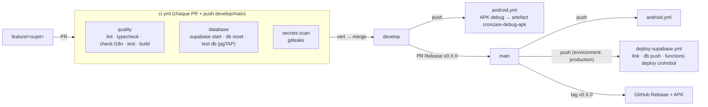

# Pipeline CI/CD



| Workflow | Déclencheur | Jobs | Bloquant pour la PR |
|---|---|---|---|
| `ci.yml` | `pull_request`, push sur `develop` / `main` | `quality`, `database`, `secrets-scan` | **Oui** (avec la protection de branche) |
| `android.yml` | push sur `develop` / `main`, manuel | `apk` → artefact `croncare-debug-apk` | Non |
| `deploy-supabase.yml` | push sur `main`, manuel | `deploy` (environment `production`) | Non |
| `dependabot.yml` | hebdomadaire | PR npm + GitHub Actions vers `develop` | — |

## Secrets GitHub à créer

**Settings → Secrets and variables → Actions → New repository secret**. Les trois premiers
peuvent aussi être placés dans l'environment `production` (**Settings → Environments → production**),
ce qui permet d'exiger une approbation manuelle avant chaque déploiement.

| Secret | Utilisé par | Où le trouver |
|---|---|---|
| `SUPABASE_ACCESS_TOKEN` | deploy-supabase | supabase.com → avatar → **Account → Access Tokens** → *Generate new token* |
| `SUPABASE_PROJECT_REF` | deploy-supabase | Dashboard du projet → **Project Settings → General → Reference ID** (ou l'URL `https://<ref>.supabase.co`) |
| `SUPABASE_DB_PASSWORD` | deploy-supabase | Mot de passe choisi à la création du projet (**Project Settings → Database → Reset database password** si perdu) |
| `VITE_SUPABASE_URL` | android | **Project Settings → API → Project URL** |
| `VITE_SUPABASE_ANON_KEY` | android | **Project Settings → API → Project API keys → anon / public** |

Sans `VITE_SUPABASE_*`, l'APK est construit mais l'application ne peut pas se connecter.
Sans les secrets `SUPABASE_*`, le job de déploiement échoue avec un message qui liste ceux qui manquent.

Secrets **Supabase**, pas GitHub, pour CrohnBot :
```bash
npx supabase secrets set ANTHROPIC_API_KEY=sk-ant-... --project-ref <ref>
npx supabase secrets set CROHNBOT_MODEL=claude-haiku-4-5 --project-ref <ref>   # optionnel
```

## Protection des branches

À faire une fois par le propriétaire du dépôt : la session Claude Code n'a pas les droits
d'administration du dépôt.

**Par l'interface** : Settings → Branches → *Add branch ruleset* (ou *Add classic protection rule*)
pour `main` puis pour `develop` :
- Require a pull request before merging
- Require status checks to pass : `quality`, `database`, `secrets-scan`
- Require branches to be up to date before merging
- Block force pushes, restrict deletions

**Par la ligne de commande** (`gh` authentifié en administrateur) :
```bash
for b in develop main; do
  gh api -X PUT repos/oussemaghanmi/app_mobile/branches/$b/protection --input - <<'JSON'
{
  "required_status_checks": { "strict": true, "contexts": ["quality", "database", "secrets-scan"] },
  "enforce_admins": false,
  "required_pull_request_reviews": { "required_approving_review_count": 0 },
  "restrictions": null,
  "allow_force_pushes": false,
  "allow_deletions": false
}
JSON
done

# Branche par défaut
gh repo edit oussemaghanmi/app_mobile --default-branch develop
```

## Installer l'APK

1. GitHub → onglet **Actions** → workflow **Android (APK debug)** → dernière exécution verte.
2. En bas, section **Artifacts** → télécharger `croncare-debug-apk` (un zip contenant `app-debug.apk`).
   Pour les versions taguées, l'APK est aussi joint à la **Release**.
3. Copier `app-debug.apk` sur le téléphone Android, l'ouvrir et autoriser l'installation depuis cette
   source (*Paramètres → Sécurité → Sources inconnues*).

## Lancer la CI en local

```bash
npm run lint && npm run typecheck && npm run check:i18n && npm test && npm run build
npm run db:start && npm run db:reset && npm run db:test
```
